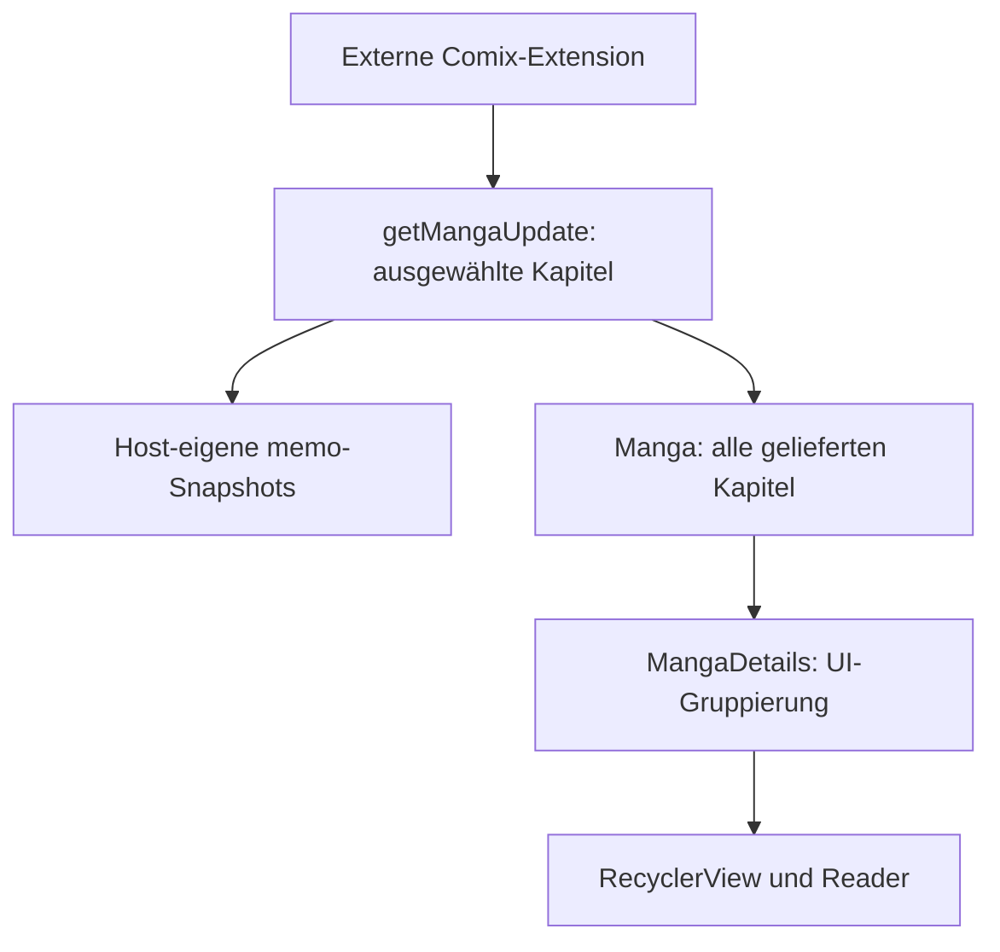

# Audit 2026-10-13

## Identität und Ausgangsstand
Futon Repository-ID 1345465394, kanonisch madebycli/Futon-MihonFIx; alter Name Futon als bestätigter Alias.
Base devel: 6f171b4f9f07ba792d02e1682da779ac739002eb, frischer sauberer Clone.
Routing .ai/CONTEXT.md passt zu REGISTRY.yaml: futon, projects/futon/, projects/futon/INDEX.md.
Keine offenen PRs vor Beginn. Release v9.8.3 bereits am 2026-09-02 publiziert, Release-CI 33611369866 erfolgreich.
Sep-1-Kontext war hinsichtlich PR/Release veraltet. Neuer Feature-Branch und Draft-PR #3; kein Merge nach devel.

## Aktuelle Referenzen
- Kototoro devel 6410cdd1e1a92031f429c46cec39b5d2ea041fa2.
- extensions-lib main 42255ee5fa96d9425697b7c143587483207308d1, unverändert gegenüber letzter ABI-Integration.
- extensions-source main e97033fe901ebd52964577d869b4549f65028cb0, nur Referenz.
- Comix-Paket eu.kanade.tachiyomi.extension.en.comix, Source-ID 7537715367149829912,
  Extension 1.6.47 aus live repo/index.json. Keine Änderung an Extension oder nativen Comix-Parsern.

## Reale bisherige Integration
Futon enthält u.a. 9eb36b573 (Hostclient), 87bbda494 (Browser-Origin), 85f19b491/d5c344c12
(Repo-/Protobuf-Handling), ffd1f4d90/93dcf7aa4 (Nummern/Metadaten), e709e75cb (Manga),
88006baa1 (gemeinsame Snapshots), 7d3e8e712 (Persistenz), 809a8900f (unabhängige Legacy-Felder).
Klassen enthalten exakte Kototoro-Provenienz-Kommentare; Graph-Identität allein ist kein Integrationsnachweis.
Source/HttpSource und SManga/SChapter behalten die moderne 1.6-ABI plus ältere Rx-/Fork-Felder.

## Delta-Matrix
| Commit/Referenz | Funktion | Entscheidung | Begründung und Gate |
| --- | --- | --- | --- |
| Kototoro 3e86e87ea78a690f1ea66ff1f28f67db8dc0a277 | Extension-eigene HTTP-Header | gezielt Verhalten portieren | Futon CommonHeaders injiziert schon nur native Parserdefaults, der Patch dort wäre redundant. Futons eigener /api/-Enricher setzt jedoch entfernte Header bei Clearance wieder ein: entfernen, API-Header-Regression mit Clearance. |
| Kototoro b2864d65a9c0f3a427cb06cfb42912fb416f8abf | Wrapped Cloudflare-/Interactive-Fehler | Unwrap portieren | Futon fängt nur RuntimeException mit unmittelbarer Ursache, verliert IOException-Ketten; 6 Regressionen. cf-error-details-Teil nicht nötig: Futon erkennt diesen Marker nicht. |
| Kototoro 262fbeb7f8933893de0559d296b69c7f5d196271 | Aniyomi HttpUrl-Executor | nicht relevant | Futon unterstützt hier Mihon/Manga, nicht Aniyomi-Video-Hoster. Keine neue Anime-ABI einführen. |
| extensions-lib 42255ee5 | Source/HttpSource, memo, getMangaUpdate | vorhanden | Moderne APIs, legacy fallback, memo-Snapshot/R8-ABI-Gates bereits enthalten. Kein Versionsbump. |
| Kototoro 8d5494c / 92b0c5d | Lazy loading / Discovery | riskant, nicht portieren | Andere Source-host-/KMP-Architektur; Futon bereits AwaitingMihonMangaRepository, keine neue Startup-Barriere. |
| Kototoro 4ce63f7 | atomarer Sync mehrerer Extension-Ökosysteme | nicht im Scope | Futons bestehende Restore-Readiness und Snapshot-Grenzen erhalten; keine Migration/Sync-Neufassung. |
| Kototoro bb44444, c7b169e und iOS/Desktop | KMP/Compose/Runtime | nicht relevant | Futon Android RecyclerView/ViewBinding; kein Plattformumbau. |
| Kototoro aktuelle CF-Orchestrierung | vollständige Browsertransport-Parität | riskant, ausgelassen | Neues Strategie-/Coordinator-System nicht blind integrieren; bestehendes offscreen solve/retry erhalten. |
| extensions-source Comix | Dedup / Ranking / memo | nur Referenz | Dedup erfolgt vor Host-Rückgabe, Alternativen daraus nicht rekonstruierbar. |

## Comix-Datenfluss und gewählter Scope

Comix selectChapters entfernt identische URLs, blacklistet und dedupliziert optional vor Rückgabe.
Ranking dort: official, groupId 10702, votes, chapterId. Alle Felder existieren tatsächlich im memo;
Futon persistiert sie, aber MangaChapter trägt memo nicht und Snapshot-Limits können Werte verdrängen.

Benutzersteuerung vom 13.10.: einfacher appseitiger Weg ohne zusätzliche Host-Dedup-Engine.
Wenn alle gelieferten Kapitel zuverlässig nummeriert und ihre (Volume, Nummer)-Keys eindeutig sind,
Gruppenaufteilung deaktivieren und vollständige Liste zeigen. Bei Duplikaten oder unklaren Nummern
bestehende Gruppen erhalten. Keine Kapitel verwerfen, keine URLs/IDs/Scanlatoren umschreiben.
Extension-Dedup AN wird so automatisch kombiniert, AUS kombiniert nur wirklich eindeutige Datensätze.
Eine Änderung der Extension-Preference erfordert den vorhandenen manuellen Refresh; reine Chipwechsel
führen keinen Abruf aus. Keine neue persistierte Filterpräferenz und kein Schemawechsel.

A (UI-/Reader-Projektion) ist ausreichend und gewählt; B (Repository-/Modelländerung) würde Originaldaten
verändern und mehr Restore-/Download-Pfade betreffen. O(n) Erkennung, existierende Sortierung bleibt bestehen.

## Upstream-Lizenz
Unwrap-Implementation und sechs Tests sind aus Kototoro b2864d65 adaptiert,
ursprünglich Apache-2.0. Package-/JUnit-Anpassungen sind in den Dateiköpfen markiert;
Lizenztext liegt unter licenses/Kototoro-Apache-2.0.txt. Die Referenzdateien tragen keine
zusätzlichen Copyright-/NOTICE-Köpfe. Futons eigene Lizenz bleibt unverändert.

## Zwischenstand A
Run 38359362344 scheiterte am SDK-Setup (Paket tools nicht mehr angeboten).
Run 38359635951 kompilierte Kotlin und führte 56 Tests aus: 55 bestanden, ein neuer
Header-Test scheiterte an nicht gemocktem android.util.Log. Logging-Mock korrigiert,
Suite für fa7907fe85ca1b07602e96c3d7c0f9666c64b09b erneut gestartet: 38360422794.
Noch kein grünes Testergebnis oder neuer APK-/Release-Nachweis zu diesem Zeitpunkt.

Focused test step of run 38360422794 passed on fa7907fe85ca1b07602e96c3d7c0f9666c64b09b; release lint still running at the beginning of package B.

## Hauptbranch-Sync und erneuter Upstream-Check (2026-10-13, Abend)

Der Benutzer hat die Übernahme aller fehlenden Futon-Commits in den Hauptbranch ausdrücklich beauftragt.
Der verifizierte Default-/Hauptbranch ist devel, nicht main. PR #3 enthält sechs seit devel fehlende
Commits; der veröffentlichte 9.8.4-Release enthält bereits sämtliche App-Änderungen. Der spätere
04b692da-Commit verändert ausschließlich Dokumentation/Kontext. Die alten Fix-Branches enthalten
keine zusätzlichen Commits außerhalb dieses Standes.

Kototoro devel bleibt 6410cdd1e1a92031f429c46cec39b5d2ea041fa2; extensions-lib main bleibt
42255ee5fa96d9425697b7c143587483207308d1. Kein neuer erforderlicher Host-Port.

extensions-source main ist jetzt 44eeaaad3f64ef9c7418afe5b2303e79d09fcf2f. Der einzige neue Commit
gegenüber e97033fe ist Comix: solve both captchas, fall back to the site's pager (#19924),
Extension-Version 1.6.48. Er verändert Extension-eigene JS-Assets und Comix.kt, ohne neuen Host-ABI:
kein Futon-App-Port und kein heimliches Kopieren/Forken der externen Extension. Der betreffende
Fix wird durch Aktualisieren der separat installierten Comix-Extension bezogen.

Die englische README behält Layout, Screenshots und Abschnittsstruktur. Entfernt wurden die
F-Droid-/IzzyOnDroid-Badges und Downloadbuttons sowie die fremde CodeTriage-Badge. Release-/Lizenz-
und Clone-Links verweisen auf dieses Repository; Android-Minimum, SDK und veröffentlichter
Signatur-Fingerprint stimmen mit dem Build überein. Distribution erfolgt über GitHub Releases.

PR #3 ist verifiziert gemergt: 78befa347ef37abed2d1d76ec0cd531e063f2a7e. Der gesamte app-/build-/test-Tree ist identisch mit v9.8.4.
README-Inhalte, lokale Bild-/Dokumentlinks und YAML wurden geprüft; keine erneute Build-/Testbehauptung für die Dokumentation.

## Correction: actual fork parent AppFuton/Futon

The earlier audit addressed compatibility reference repositories. It did not establish that the
actual AppFuton fork parent had no missing commits. The actual parent was six commits ahead through
5d2206a6926adf53be0867ad784948ed16663f44 (upstream v9.8.2).
See [APPFUTON-SYNC.md](APPFUTON-SYNC.md) for the complete parent merge and retained Mihon fixes.
